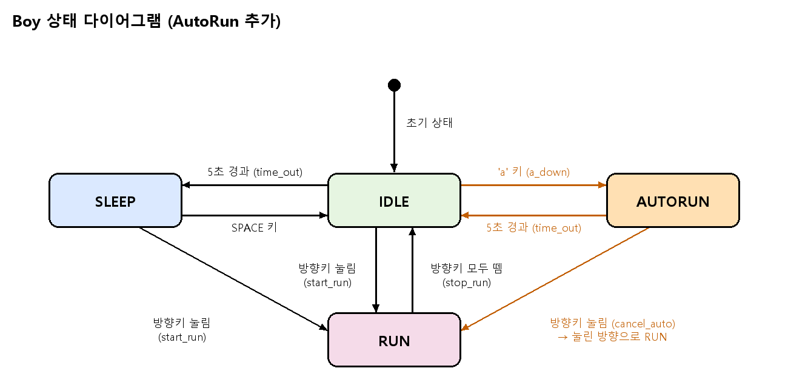

# AutoRun (자동 무적 런) 상태 추가

## 1. 요구사항

- IDLE 상태에서 `a` 키를 누르면 소년(Boy)은 **자동 무적 런(AutoRun) 상태**가 된다.
  - 키 조작이 없어도 계속 좌우로 이동한다.
  - 평소보다 **속도가 빨라지고**, **크기가 확대**된다.
  - 화면 좌우 끝(x = 0, x = 800)에 닿으면 **자동으로 방향 전환**한다.
- AutoRun 상태에서 **5초가 경과**하면 IDLE 상태로 돌아간다.
- AutoRun 상태에서 **방향키가 눌리면** 무적 런이 취소되고, 눌린 방향으로 움직이는 **원래의 RUN 상태**가 된다.
- **중요:** 반드시 `AutoRun` **상태 클래스를 추가**해서 구현해야 한다.
- **중요:** 상태 다이어그램을 함께 제출한다. (아래 이미지)

## 2. 상태 다이어그램



## 3. 상태 전이표

| 현재 상태 | 이벤트 | 다음 상태 | 비고 |
|-----------|--------|-----------|------|
| IDLE | 5초 경과 (time_out) | SLEEP | 기존 |
| SLEEP | SPACE 키 | IDLE | 기존 |
| IDLE, SLEEP | 방향키 눌림 (start_run) | RUN | 기존 |
| RUN | 방향키 모두 뗌 (stop_run) | IDLE | 기존 |
| IDLE | `a` 키 (a_down) | **AUTORUN** | 신규 |
| AUTORUN | 5초 경과 (time_out) | IDLE | 신규 |
| AUTORUN | 방향키 눌림 (cancel_auto) | RUN | 신규, 눌린 방향으로 RUN |

## 4. 상태별 동작 (AutoRun)

| 항목 | 내용 |
|------|------|
| enter | 시작 시각 기록, 프레임 0, 현재 `face_dir`로 이동 방향 설정 |
| do (update) | 프레임 갱신, 빠른 속도로 이동, 화면 끝에서 `dir` 부호 반전 |
| draw | 확대된 크기(예: 200x200)로 `dir` 방향의 달리기 스프라이트 출력 |
| exit | 크기/속도 원복 |
| 종료 조건 | 시작 후 5초 경과 → IDLE |

## 5. 구현 가이드

- `AutoRun` 클래스를 별도로 추가한다. (`enter / exit / do / draw` 구조, 기존 상태 클래스와 동일한 형태)
- 이동 속도는 RUN보다 빠르게 한다. (예: RUN의 2배)
- 화면 끝 방향 전환 예시:

```python
if self.boy.x >= 800:
    self.boy.dir = -1
elif self.boy.x <= 0:
    self.boy.dir = 1
self.boy.face_dir = self.boy.dir
```

- 상태 전이 규칙에 위 표의 세 가지 전이를 추가한다.
  - IDLE → AUTORUN (`a` 키 입력)
  - AUTORUN → IDLE (5초 time_out)
  - AUTORUN → RUN (방향키 입력, 눌린 방향 유지)

> 참고: 현재 [boy.py](boy.py)는 `transitions` 라이브러리의 `Machine`으로 상태를 관리하고 있으므로, 구현 시 상태 클래스 구조로 맞춰야 하는지 확인이 필요하다.
